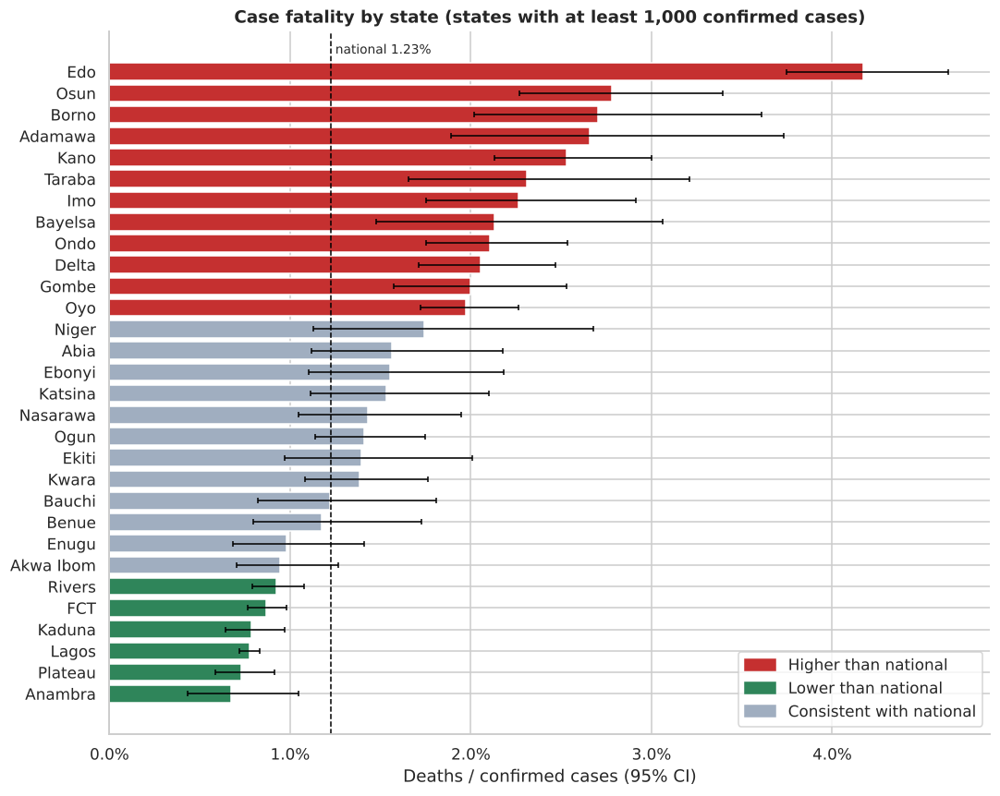

# Data Analysis and Modelling with Power BI and Python

Three analytics projects that pair **Power BI data modelling and dashboards** with **Python analysis** (pandas, statistics, matplotlib/seaborn).
The Power BI reports answer *"what happened?"*; the notebooks go further, asking *why*, and testing whether patterns are real.

| Project | Tools | What it shows |
|---|---|---|
| [**Superstore sales**](notebooks/superstore_sales_analysis.ipynb) | Power BI (star schema, DAX), Python | Growth, seasonality, loss-making products and the effect of discounting |
| [**Nigeria Covid-19**](notebooks/nigeria_covid19_analysis.ipynb) | Power BI (web scrape, DAX), Python | State-level burden and fatality rates with confidence intervals |
| [**Disney box office**](notebooks/disney_box_office_analysis.ipynb) | Python | Genre and rating revenue, inflation-adjusted comparison, statistical tests |

---

## 1. Superstore sales: where profit is made and lost

**Power BI:** [`powerbi/sales-report-data-modelling.pbix`](powerbi/sales-report-data-modelling.pbix), a star-schema model with 12 DAX measures and two report pages.
**Python:** [`notebooks/superstore_sales_analysis.ipynb`](notebooks/superstore_sales_analysis.ipynb), 9,994 order lines, 2014-2017.

| Sales | Profit | Margin | Orders | Customers |
|---|---|---|---|---|
| $2.30M | $286K | 12.5% | 5,009 | 793 |

Key findings (all computed in the notebook):

- **Growth is real but uneven.** Sales rose from $484K (2014) to $733K (2017), about 15% a year. 2015 dipped 2.8% while profit still grew 24%, and margin improved from 10.2% to 12.7% over the period.
- **Year-end carries the year.** November and December together deliver about 30% of annual sales (an even spread would be 17%).
- **Three sub-categories lose money:** Tables (-$18K), Bookcases (-$3K) and Supplies (-$1K), while Copiers, Phones and Accessories earn the most.
- **Discounting drives the losses.** Margin is 29.5% with no discount but -77% on discounts over 40%. Lines discounted more than 20% are 14% of all lines but account for 89% of all losses.
- **Texas is the weakest state** (-$26K); the West is the strongest region.


## 2. Nigeria Covid-19: severity, not just volume

**Power BI:** [`powerbi/nigeria-covid19-dashboard.pbix`](powerbi/nigeria-covid19-dashboard.pbix), a one-page dashboard fed by a Power Query web scrape.
**Python:** [`notebooks/nigeria_covid19_analysis.ipynb`](notebooks/nigeria_covid19_analysis.ipynb), a snapshot of 37 states (36 + FCT).

| Confirmed | Deaths | Recovery rate | Death rate |
|---|---|---|---|
| 256,028 | 3,143 | 97.7% | 1.23% (95% CI 1.19%-1.27%) |

- **Validated first:** in every state, active + discharged + deaths equals confirmed.
- **Highly concentrated:** Lagos holds 39% of cases and the top five states 65%.
- **Volume is not severity.** Lagos has the most deaths but a below-average death rate (0.77%). Using Wilson confidence intervals, 12 states have a rate significantly above the national rate and 6 significantly below; small states (under 1,000 cases) are excluded because a raw rate such as 2 deaths in 5 cases (40%) is just noise.



## 3. Disney box office: genre, rating and inflation

**Python:** [`notebooks/disney_box_office_analysis.ipynb`](notebooks/disney_box_office_analysis.ipynb) on 579 Disney films.
The original exploration is kept as [`notebooks/disney_genre_exploration_v1.ipynb`](notebooks/disney_genre_exploration_v1.ipynb).

What the original run showed: the typical film is much smaller than the average (nominal median $30.7M vs mean $64.7M), and nominal grosses are not comparable across eras (*Snow White* grossed $185M nominal but $5.23B inflation-adjusted).

The rewritten notebook fixes the original's main weaknesses: it uses the inflation-adjusted gross, summarises by median as well as total, replaces charts that do not suit this data (radar, 3D bar, hexbin, parallel coordinates) with readable ones, adds a data-quality audit, and tests whether genre differences are statistically real (Kruskal-Wallis with effect size).

> **Needs one file:** the dataset is not included in this repo. Save `disney_movies.csv` into `data/` (see [`data/README.md`](data/README.md)) and run the notebook. All findings in it are computed, not typed in.

---

## Repository layout

```
.
├── notebooks/            Python analyses (Superstore and Covid-19 notebooks include executed outputs)
├── powerbi/              Power BI reports (.pbix) and a guide to their data models and DAX
├── data/                 CSV data used by the notebooks (see data/README.md)
├── scripts/              export_pbix_data.py: extracts the data embedded in the .pbix files
└── reports/figures/      Charts used in this README
```

## Running it

```bash
pip install -r requirements.txt
jupyter lab                      # open any notebook in notebooks/ and Run All
```

The two Power BI notebooks run as-is, because their data is already in `data/`. To regenerate those CSVs from the `.pbix` files:

```bash
pip install pbixray
python scripts/export_pbix_data.py
```

To explore the dashboards, open the `.pbix` files in Power BI Desktop. See [`powerbi/README.md`](powerbi/README.md) for what each contains.

## Skills demonstrated

Data modelling (star schema, relationships) · DAX (time intelligence, ratio measures) · Power Query (web and Excel sources) ·
data validation and quality audits · exploratory analysis · statistical testing (Kruskal-Wallis, Spearman, Wilson intervals) ·
data visualisation · clear written findings and caveats.
