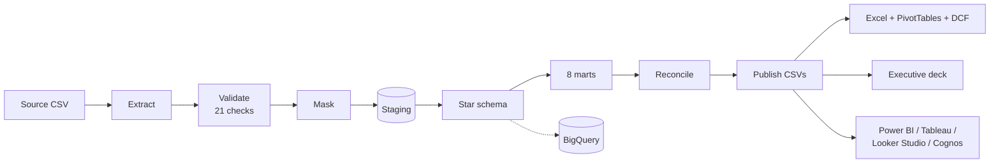
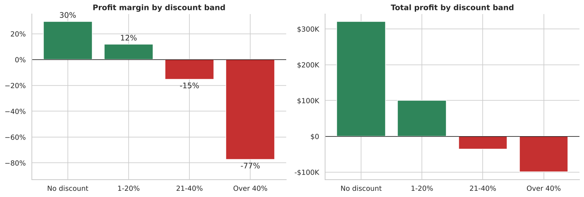
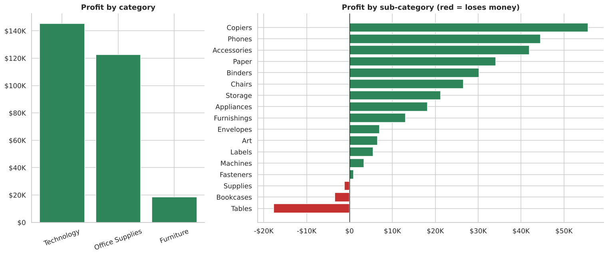

# Data Analysis and Modelling: Power BI, Python, SQL and Excel

[](https://github.com/Ritik7nehra/data-analyse-modelling-with-power-BI/actions/workflows/ci.yml)

An end-to-end analytics project built around the Superstore sales data: a **tested ETL pipeline** with data-quality gates and **data masking**, a **star-schema warehouse** (DuckDB, with BigQuery DDL), BI marts, an **Excel workbook** with lookups and pivot tables, an illustrative **DCF valuation**, an **executive PowerPoint deck**, the original **Power BI reports**, and **CI workflows**. Two further projects (Nigeria Covid-19 and Disney box office) pair Power BI and Python analysis.

**How to read the status labels:** ✅ built **and** tested or verified in this repo. 🟡 written but **not run**, because it needs an account or tool that was not available here (BigQuery, Looker Studio, Tableau, Cognos, Fabric, and the two manual GitHub workflows). Those parts are specifications to build from, not claims of experience.

## What is in this repo

| Area | What it contains | Where | Status |
|---|---|---|---|
| ETL and pipeline management | Extract, validate (21 checks), mask, load, model, reconcile, publish; step DAG with fail-fast, JSONL run log, idempotent and byte-reproducible | [`src/`](src/superstore_pipeline), [`config/`](config), [docs](docs/pipeline_management.md) | ✅ |
| Data masking | HMAC-SHA256 pseudonymisation, postcode generalisation, leak check, k-anonymity report | [`mask.py`](src/superstore_pipeline/mask.py), [docs](docs/data_masking.md) | ✅ (committed outputs use a public dev key, see the doc) |
| SQL modelling (warehouse) | Star schema (4 dimensions, 1 fact) and 8 marts incl. window functions, RFM, ROLLUP, discount what-if | [`warehouse/duckdb/`](warehouse/duckdb/models) | ✅ executed and tested |
| BigQuery modelling | Partitioned and clustered DDL, views, loader with dry run | [`warehouse/bigquery/`](warehouse/bigquery) | 🟡 parsed and dry-run only |
| Power Query (ETL) | M queries extracted from the reports and refactored (staging query, parameters) | [`powerquery/`](powerquery) | 🟡 |
| Excel lookups and pivot tables | INDEX/MATCH, VLOOKUP, SUMIFS pivot-style summaries, native PivotTables, charts, data validation | [`excel/`](excel) | ✅ values verified against pandas |
| Financial modelling and valuation | Three-scenario DCF, WACC, WACC x growth sensitivity, Python cross-check | [`excel/finance/`](excel/finance), [`valuation.py`](src/superstore_pipeline/valuation.py) | ✅ mechanics (inputs are illustrative) |
| Power BI sales report | Original `.pbix` reports, data model notes, proposed measures for the masked data | [`powerbi/`](powerbi) | ✅ original reports / 🟡 proposed measures |
| BI dashboards: Looker Studio, Tableau, Cognos | One metric layer (SQL tested; DAX, Tableau, Looker Studio hand-written) and build guides | [`bi/`](bi) | 🟡 guides, no published dashboards |
| Reports and PowerPoint | 10-slide executive deck with native charts and speaker notes | [`reports/`](reports) | ✅ |
| CI/CD | CI: lint, tests on Python 3.11 and 3.13, strict-mode pipeline run, notebook execution | [`.github/workflows/ci.yml`](.github/workflows/ci.yml) | ✅ passing on GitHub Actions |
| Manual workflows: rebuild deliverables, deploy to BigQuery | [`.github/workflows/`](.github/workflows) | 🟡 not run |
| Microsoft Fabric | Component-by-component mapping | [`docs/fabric_mapping.md`](docs/fabric_mapping.md) | 🟡 mapping only |
| Notebooks | Three analyses (Superstore, Covid-19, Disney) | [`notebooks/`](notebooks) | ✅ two executed; Disney needs a CSV you add |

## Architecture



Solid lines are built and tested; dotted lines are written but not run. Details: [`docs/architecture.md`](docs/architecture.md).

## Quick start

```bash
pip install -e ".[dev,deliverables]"
python -m superstore_pipeline run        # extract, validate, mask, load, model, reconcile, publish
pytest                                    # masking, validation, pipeline, SQL, marts, Excel, DCF and deck tests
ruff check . --exclude notebooks
```

`make help` lists every target (`make pipeline`, `make test`, `make excel`, `make dcf`, `make deck`, `make bq-dry-run`).
Without `MASKING_KEY` the pipeline uses a public dev key and warns; set the variable and add `--strict-masking` for anything real.

Key numbers the pipeline reconciles to on every run: **9,994 rows, $2,297,200.86 sales, $286,397.02 profit** (it stops if they differ).

## Start here

| If you want to | Open |
|---|---|
| See the findings in 10 slides | [`reports/Superstore_Executive_Deck.pptx`](reports/Superstore_Executive_Deck.pptx) |
| Try lookups and pivot tables | [`excel/Superstore_Sales_Analysis.xlsx`](excel/Superstore_Sales_Analysis.xlsx) (Lookups sheet) and [`excel/Superstore_PivotTables.xlsx`](excel/Superstore_PivotTables.xlsx) |
| Change valuation assumptions | [`excel/finance/Superstore_DCF_Valuation.xlsx`](excel/finance/Superstore_DCF_Valuation.xlsx) (Assumptions sheet) |
| Read how the pipeline is run and recovered | [`docs/pipeline_management.md`](docs/pipeline_management.md) |
| Build a Looker Studio, Tableau or Cognos dashboard | [`bi/README.md`](bi/README.md) |

---

## 1. Superstore sales: where profit is made and lost

**Power BI:** [`powerbi/sales-report-data-modelling.pbix`](powerbi/sales-report-data-modelling.pbix), a star-schema model with 12 DAX measures and two report pages.
**Python:** [`notebooks/superstore_sales_analysis.ipynb`](notebooks/superstore_sales_analysis.ipynb), 9,994 order lines, 2014-2017.

| Sales | Profit | Margin | Orders | Customers |
|---|---|---|---|---|
| $2.30M | $286K | 12.5% | 5,009 | 793 |

Key findings (all computed in the notebook):

- **Growth is real but uneven.** Sales rose from $484K (2014) to $733K (2017), about 15% a year. 2015 dipped 2.8% while profit still grew 24%, and margin improved from 10.2% to 12.7% over the period.
- **Year-end carries the year.** November and December together deliver about 30% of annual sales (an even spread would be 17%).
- **Three sub-categories lose money:** Tables (-$18K), Bookcases (-$3K) and Supplies (-$1K), while Copiers, Phones and Accessories earn the most.
- **Discounting drives the losses.** Margin is 29.5% with no discount but -77% on discounts over 40%. Lines discounted more than 20% are 14% of all lines but account for 89% of all losses.
- **Texas is the weakest state** (-$26K); the West is the strongest region.




## 2. Nigeria Covid-19: severity, not just volume

**Power BI:** [`powerbi/nigeria-covid19-dashboard.pbix`](powerbi/nigeria-covid19-dashboard.pbix), a one-page dashboard fed by a Power Query web scrape.
**Python:** [`notebooks/nigeria_covid19_analysis.ipynb`](notebooks/nigeria_covid19_analysis.ipynb), a snapshot of 37 states (36 + FCT).

| Confirmed | Deaths | Recovery rate | Death rate |
|---|---|---|---|
| 256,028 | 3,143 | 97.7% | 1.23% (95% CI 1.19%-1.27%) |

- **Validated first:** in every state, active + discharged + deaths equals confirmed.
- **Highly concentrated:** Lagos holds 39% of cases and the top five states 65%.
- **Volume is not severity.** Lagos has the most deaths but a below-average death rate (0.77%). Using Wilson confidence intervals, 12 states have a rate significantly above the national rate and 6 significantly below; small states (under 1,000 cases) are excluded because a raw rate such as 2 deaths in 5 cases (40%) is just noise.


## 3. Disney box office: genre, rating and inflation

**Python:** [`notebooks/disney_box_office_analysis.ipynb`](notebooks/disney_box_office_analysis.ipynb) on 579 Disney films.
The original exploration is kept as [`notebooks/disney_genre_exploration_v1.ipynb`](notebooks/disney_genre_exploration_v1.ipynb).

What the original run showed: the typical film is much smaller than the average (nominal median $30.7M vs mean $64.7M), and nominal grosses are not comparable across eras (*Snow White* grossed $185M nominal but $5.23B inflation-adjusted).

The rewritten notebook fixes the original's main weaknesses: it uses the inflation-adjusted gross, summarises by median as well as total, replaces charts that do not suit this data (radar, 3D bar, hexbin, parallel coordinates) with readable ones, adds a data-quality audit, and tests whether genre differences are statistically real (Kruskal-Wallis with effect size).

> **Needs one file:** the dataset is not included in this repo. Save `disney_movies.csv` into `data/` (see [`data/README.md`](data/README.md)) and run the notebook. All findings in it are computed, not typed in.

---

---

## Repository layout

```
.
├── src/superstore_pipeline/   ETL package: extract, validate, mask, warehouse, runner, CLI, valuation
├── config/                    pipeline.yml (paths, masking, control totals)
├── warehouse/
│   ├── duckdb/models/         SQL models: dimensions, fact, marts (executed and tested)
│   └── bigquery/              BigQuery DDL, views and loader (not run against BigQuery)
├── powerquery/                Power Query (M) queries and parameters
├── bi/                        Metric layer (metrics.yml), generated reference, Looker Studio / Tableau / Cognos guides
├── excel/                     Workbook with lookups and pivots, native PivotTables, finance/ (DCF)
├── reports/                   Executive deck (+ build scripts), marts/ (BI-ready CSVs), figures/
├── powerbi/                   Power BI reports (.pbix), model notes, proposed DAX measures
├── notebooks/                 Python analyses (Superstore and Covid-19 include executed outputs)
├── tests/                     pytest suite: masking, validation, pipeline, marts, SQL, metrics, deliverables, valuation
├── docs/                      Architecture, data masking, pipeline management, Fabric mapping
├── data/                      Source CSVs used by the notebooks and the pipeline
├── scripts/                   export_pbix_data.py: extracts the data embedded in the .pbix files
└── .github/workflows/         CI and manual workflows
```

## Running the notebooks

```bash
pip install -r requirements.txt
jupyter lab                      # open any notebook in notebooks/ and Run All
```

The two Power BI notebooks run as-is, because their data is already in `data/`. To regenerate those CSVs from the `.pbix` files:

```bash
pip install pbixray
python scripts/export_pbix_data.py
```

## Known limitations

- **Customer tokens in committed outputs use a public dev key**, so they offer no secrecy (the source is a public sample data set). Real use needs a secret key; see [`docs/data_masking.md`](docs/data_masking.md).
- **The DCF inputs are illustrative placeholders**, and the dataset has no balance sheet. Treat it as a demonstration of modelling mechanics, not a valuation.
- **The discount what-if is a scenario, not a forecast.** It brackets outcomes with an upper bound and a floor because demand response to price is unknown.
- **Native PivotTables were generated with LibreOffice**; open them in Excel and refresh to confirm they behave in your version.
- **The Superstore Power BI model has no relationship from the date table to `Orders`** (see [`powerbi/README.md`](powerbi/README.md)).
- **The Disney notebook needs a CSV that is not in the repo** (see [`data/README.md`](data/README.md)).

## Skills demonstrated

Python ETL and pipeline design (validation gates, run logging, idempotency, reproducible outputs) · data masking (pseudonymisation, generalisation, key management) ·
SQL modelling (star schema, window functions, ROLLUP, partitioned and clustered BigQuery DDL) · Excel (INDEX/MATCH, VLOOKUP, SUMIFS, PivotTables, data validation, charts) ·
financial modelling (DCF, WACC, scenarios, sensitivity, cross-checking a spreadsheet against code) · Power BI data modelling and DAX · Power Query ·
statistical analysis (Kruskal-Wallis, Spearman, Wilson intervals) · stakeholder reporting (executive deck) · testing and CI.
