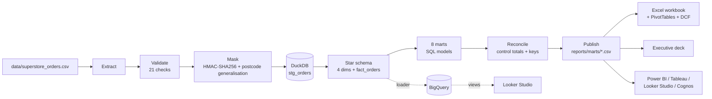

# Architecture

How the Superstore data flows from a source file to dashboards, workbooks and a deck.

Solid lines are built and tested in this repository. Dotted lines (BigQuery and anything downstream of it) are written but have not been run against a real BigQuery project.

## Layers

| Layer | Objects | Built by | Purpose |
|---|---|---|---|
| Raw | `data/superstore_orders.csv` | n/a | Source as received |
| Staging | `stg_orders` | `warehouse.load_staging` | Masked, typed copy of the source. Nothing downstream sees raw IDs |
| Core (star schema) | `dim_date`, `dim_customer`, `dim_product`, `dim_geography`, `fact_orders` | `warehouse/duckdb/models/1x`, `20` | Conformed dimensions and one fact table at order-line grain |
| Marts | `mart_monthly_sales`, `mart_product_profitability`, `mart_regional_performance`, `mart_discount_impact`, `mart_customer_rfm`, `mart_discount_what_if`, `mart_executive_kpis`, `mart_sales_flat` | `warehouse/duckdb/models/3x` | Answer-shaped tables for BI tools |
| Serving | `reports/marts/*.csv`, BigQuery views | `publish`, `warehouse/bigquery` | What Excel, decks and BI tools read |
| Metadata | `pipeline_runs`, `dq_results`, JSONL run log, `build/data_quality_report.json` | `runner` | Lineage and evidence for every run |

## Design decisions

- **SQL lives in `.sql` files, not Python strings.** The models are readable, reviewable and parsed statically in tests (`tests/test_sql_static.py` uses sqlglot in both DuckDB and BigQuery dialects).
- **DuckDB locally, BigQuery as the target.** DuckDB runs anywhere with no account, so every model is actually executed and tested. `warehouse/bigquery/` holds the equivalent DDL, views and loader.
- **Mask at the edge.** Masking is the step right after validation. The warehouse, marts, workbooks and deck only ever contain tokens (see [data_masking.md](data_masking.md)).
- **Quality gates with severities.** An *error* check stops the run; a *warning* is recorded and reported but lets the run continue. The three current warnings are real quirks in the source data (see [pipeline_management.md](pipeline_management.md)).
- **Reconcile before publish.** Loaded totals must match control totals (row count, sales, profit) and the star schema must have no orphan foreign keys, otherwise nothing is published.
- **Idempotent and deterministic.** The warehouse is rebuilt from scratch each run. DuckDB runs single-threaded so floating-point aggregation order is fixed, and exports round doubles to 6 decimals. Two runs produce byte-identical marts (tested).
- **One metric layer.** `bi/metrics.yml` defines each KPI once, as SQL (tested against pandas) and as hand-written DAX, Tableau and Looker Studio expressions.

## Where each deliverable comes from

| Deliverable | Reads | Built by |
|---|---|---|
| `excel/Superstore_Sales_Analysis.xlsx` | `mart_sales_flat`, `mart_customer_rfm` | `excel/build_workbook.py` |
| `excel/Superstore_PivotTables.xlsx` | `mart_sales_flat` | `excel/build_pivottables.py` (LibreOffice) |
| `excel/finance/Superstore_DCF_Valuation.xlsx` | `mart_sales_flat` (annual totals) | `excel/finance/build_dcf.py`, assumptions from `src/superstore_pipeline/valuation.py` |
| `reports/Superstore_Executive_Deck.pptx` | all marts + valuation module | `reports/deck/*` |

## What is not covered

- No incremental loads: the data set is small, so every run is a full rebuild.
- No orchestrator, scheduler or alerting beyond the CI workflows (see [pipeline_management.md](pipeline_management.md)).
- No semantic-model deployment: the Power BI files are the original reports; the new BI assets are specifications and snippets.
